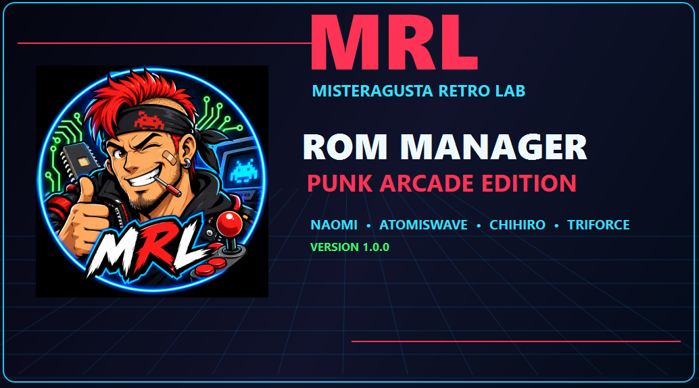
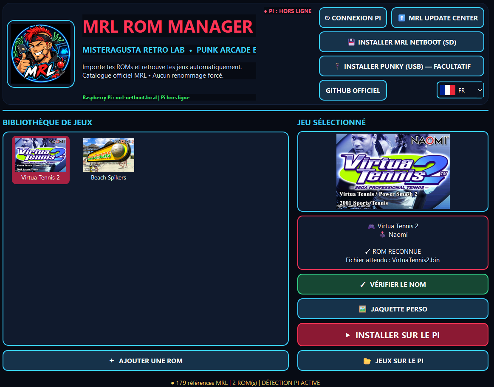
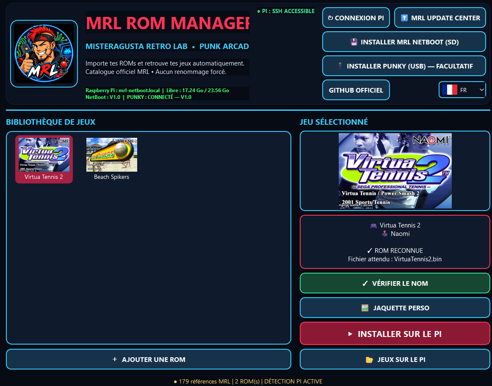
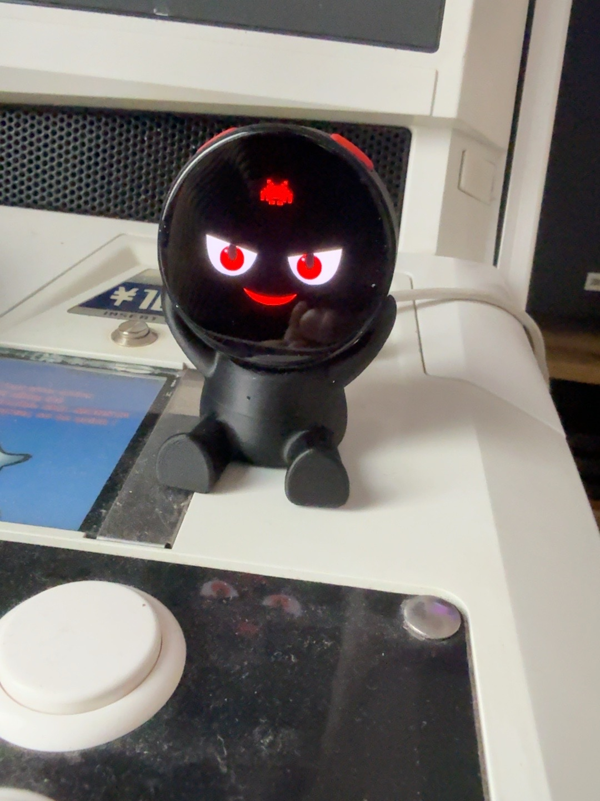
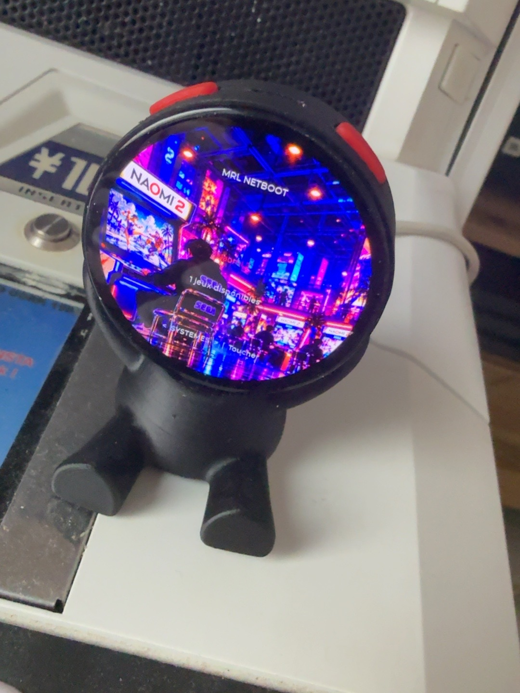
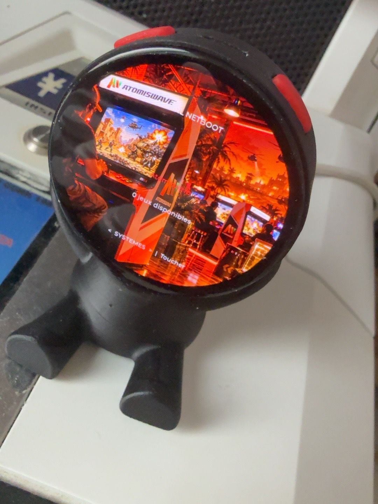
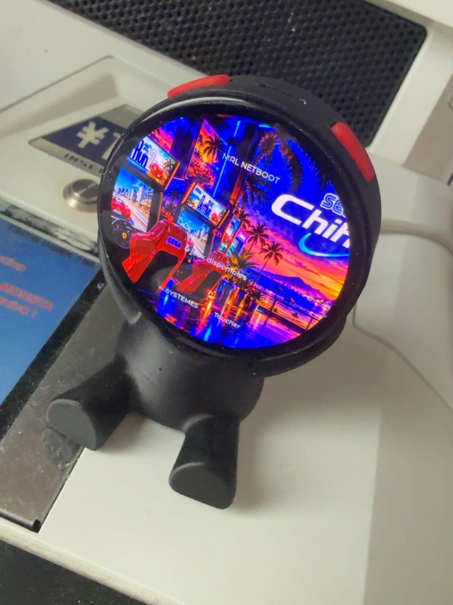
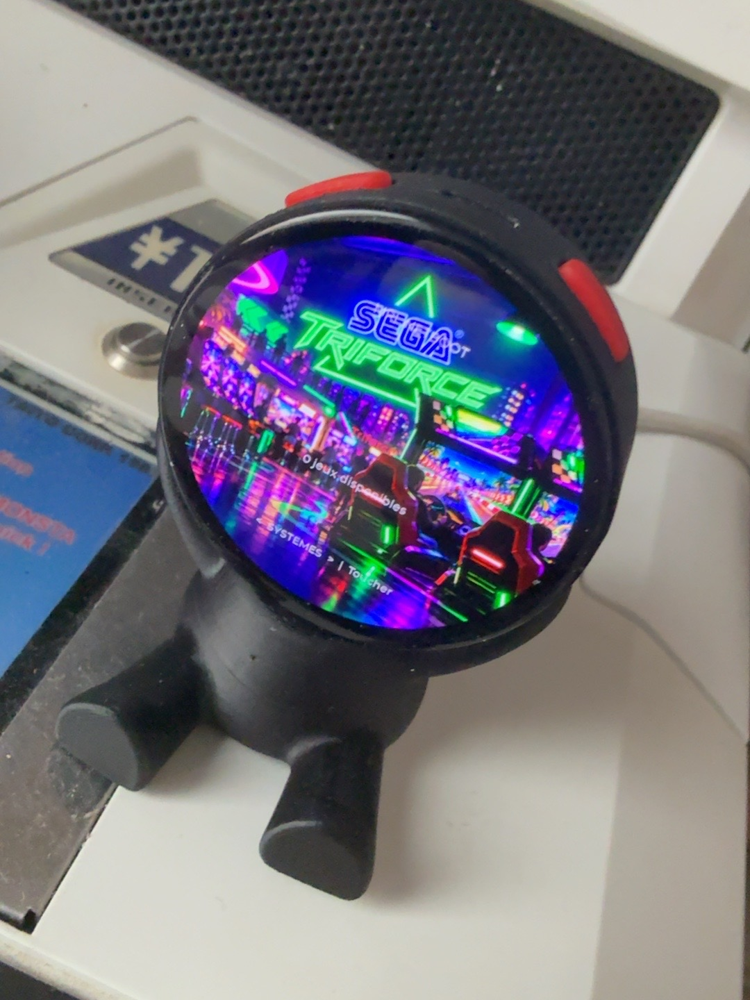
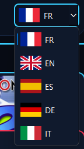

# 🎮 MisterAgusta Retro Lab — V1.0.0
### 🔥 PUNK ARCADE EDITION

**Votre écosystème NetBoot arcade, gratuit, multilingue et modulaire.**

MRL simplifie la gestion des jeux et le lancement sur du véritable matériel arcade : **SEGA Naomi, Naomi 2, Atomiswave, Chihiro et Triforce**.

## 🚀 Trois composants, un seul écosystème

### 💻 MRL ROM Manager V1.0

Une application Windows simple, pensée pour les passionnés d'arcade, même débutants.

- Reconnaissance automatique des ROMs compatibles.
- Catalogue de **179 références MRL**.
- Jaquettes automatiquement associées aux jeux.
- Possibilité d'utiliser des **jaquettes personnalisées**.
- Transfert des jeux vers le Raspberry Pi.
- Consultation et suppression des jeux présents sur le Pi.
- Détection automatique du Raspberry Pi, de NetBoot et de PUNKY.
- Installation NetBoot sur microSD et PUNKY par USB.
- Réinitialisation facultative des données locales.

### 🍓 MRL NetBoot V1.0

Le cœur du système, conçu pour Raspberry Pi 3B+.

- Interface arcade avec catalogue, favoris et jaquettes.
- Gestion de Naomi, Naomi 2, Atomiswave, Chihiro et Triforce.
- Transfert de jeux vers une NetDIMM compatible.
- Communication avec ROM Manager et PUNKY.

### 😈 PUNKY V1.0 — Le compagnon arcade vivant !

PUNKY est un assistant tactile ESP32-S3 à écran rond.

**Il est animé et réagit à votre arcade !**

- Ses yeux bougent et donnent vie à son visage malicieux.
- Quand une ROM est lancée, son visage devient **HAPPY** ! 😄
- Il permet de consulter le catalogue et de lancer les jeux.
- Il propose plusieurs langues.
- Il peut régler la luminosité et commander l'extinction du Raspberry Pi.

**Commandes tactiles :**

| Geste | Fonction |
|---|---|
| Glissement à droite → | Réglage de la luminosité |
| Glissement vers le bas ↓ | Retour à l'écran précédent |
| Glissement à gauche ← | Accès au bouton OFF du Raspberry Pi |

**Quelques systèmes présentés sur PUNKY :**

| Naomi 2 | Atomiswave |
|---|---|
|  |  |

| Chihiro | Triforce |
|---|---|
|  |  |

## 🕹️ Une installation modulaire

Le Raspberry Pi peut fonctionner :

- Seul, sans écran supplémentaire.
- Avec un écran tactile 3,5 pouces.
- Avec PUNKY ESP32-S3.
- Avec l'écran 3,5 pouces **et** PUNKY simultanément.

**PUNKY et l'écran 3,5 pouces sont indépendants et facultatifs.**

## 🌍 Cinq langues

**🇫🇷 Français · 🇬🇧 English · 🇪🇸 Español · 🇩🇪 Deutsch · 🇮🇹 Italiano**

MRL ROM Manager et PUNKY proposent une interface multilingue.

## 📦 Téléchargement et installation

La V1.0 comprend deux fichiers de distribution :

**`MRL_ROM_MANAGER_V1.0_SETUP.exe`** — L'installateur Windows, avec PUNKY USB intégré.

**`MRL_NETBOOT_V1.0.img`** — L'image système pour Raspberry Pi, distribuée séparément.

### Guide rapide

1. Téléchargez et installez **MRL ROM Manager V1.0**.
2. Téléchargez l'image **MRL NetBoot V1.0**, puis reconstituez-la si elle est fournie en plusieurs parties.
3. Dans ROM Manager, cliquez sur **INSTALLER MRL NETBOOT (SD)**.
4. Sélectionnez l'image `.img`, la carte microSD et, si nécessaire, votre réseau Wi-Fi.
5. Lancez la gravure, puis démarrez votre Raspberry Pi.
6. Facultatif : installez PUNKY depuis **INSTALLER PUNKY (USB)**.
7. Importez vos propres ROMs compatibles et transférez-les vers le Raspberry Pi.

**Attention :** la gravure efface entièrement la carte microSD sélectionnée.

Aucune ROM commerciale ni aucun BIOS protégé n'est fourni avec MRL.

## 🧪 Validé sur matériel réel

La V1.0 a été testée sur **Raspberry Pi 3B+, PUNKY ESP32-S3 et SEGA Naomi 2 avec NetDIMM**.

Tests réussis : installation complète depuis zéro, connexion de l'écosystème, transfert et lancement de *Beach Spikers*, puis changement de jeu vers *Virtua Tennis 2*.

Les tests réalisés ne garantissent pas la compatibilité de toutes les configurations matérielles.

## 🖨️ Boîtier PUNKY — Impression 3D

Le fichier **STL du boîtier PUNKY** sera partagé gratuitement après validation des tests d'impression et de montage.

**À venir — pas encore disponible.**

## ☕ Soutenir le projet

MisterAgusta Retro Lab est **gratuit** et indépendant.

Si vous souhaitez soutenir les tests matériels et les futures évolutions :

**[☕ Offrir un café à MisterAgusta Retro Lab](https://buymeacoffee.com/h9o25wuymm)**

Les contributions sont entièrement facultatives.

---

**MisterAgusta Retro Lab — Punk Arcade Edition**

*Deux roues pour l'âme… et de l'arcade pour le cœur.* 😈🎮❤️
